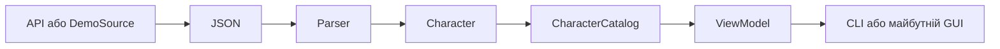

# Дизайн-документ: Каталог персонажів Genshin Impact

## 1. Опис застосунку

Програма отримує JSON-дані персонажів Genshin Impact з API та перетворює їх на внутрішні об'єкти, придатні для відображення у графічному інтерфейсі. Для практичної роботи №14 реалізовано **шар бізнес-логіки**, а для його демонстрації — простий консольний інтерфейс.

## 2. Бізнес-логіка

### 2.1. Моделі даних

`Character` — модель персонажа з такими властивостями:

- `id` — унікальний ідентифікатор персонажа (slug);
- `name`, `title`, `description` — основна текстова інформація;
- `element`, `weapon`, `region` — стихія, зброя та регіон;
- `rarity` — рідкість (ціле число 1–5 або 0, якщо невідома);
- `image_url` — посилання на картку персонажа.

Модель має метод `to_view_model()`, який повертає словник із полями для GUI, включно із текстовими зірочками рідкості (`"★" * rarity`). Графічна оболонка не працює напряму з JSON від API.

`CharacterCatalog` — основний клас бізнес-логіки. Його методи:

- `refresh()` — отримати і розібрати дані та оновити список;
- `get(id)` — знайти персонажа за ідентифікатором;
- `search(query, element, weapon, min_rarity, sort_by)` — пошук, фільтрація та сортування;
- `get_view_models(...)` — повернути список даних для відображення;
- `get_statistics()` — підрахувати персонажів за стихією і рідкістю.

### 2.2. Обробка JSON

Джерело даних отримує відповідь `GET https://genshin.jmp.blue/characters/all?lang=en`. Парсер приймає словник `id → об'єкт` або список об'єктів з полем `id`, що зручно для тестування.

Правила перетворення:

1. Поле `vision` з API перетворюється на `element` моделі, `nation` — на `region`, `weapon` — на `weapon`.
2. Відсутні необов'язкові текстові значення замінюються на «Невідомо» або порожній рядок.
3. Рідкість конвертується в ціле число: допустимі значення 1–5, невірні — 0.
4. Без коректного `id` або непорожнього `name` персонаж не додається.
5. Повторні записи з однаковим `id` відкидаються.
6. Для зображення формується URL `/characters/{id}/card`; якщо він недоступний, майбутній GUI повинен показати стандартну заглушку.

### 2.3. Логіка пошуку й фільтрів

Пошук перевіряє наявність введеного фрагмента у `name` або `id`, без урахування регістру. Коли користувач встановлює фільтри `element`, `weapon` та `min_rarity`, вони застосовуються одночасно за логічним **AND**. Умова рідкості: `character.rarity >= min_rarity`.

Режими сортування: `name` — за назвою (А–Я), `rarity` — від більшої рідкості до меншої. За однакової рідкості використовується алфавітний порядок. У разі неправильного параметра пошуку виникає `ValueError`.

### 2.4. Підготовка для графічного інтерфейсу

Метод `get_view_models()` віддає список словників із базовими типами Python — `str` та `int`. Компонент графічного інтерфейсу зможе безпосередньо використати ці дані для карток персонажів, списків, випадаючих фільтрів і поля пошуку. Бізнес-логіка **не імпортує GUI** і не залежить від його бібліотеки.

## 3. Архітектура і розподіл відповідальності

| Компонент | Завдання |
| --- | --- |
| `GenshinApiClient` | Отримання відповіді від HTTP API, обробка мережевих помилок |
| `DemoSource` | Повернення тестового JSON без мережі |
| `parser.py` | Перетворення зовнішнього JSON на моделі |
| `Character` | Нормалізована інформація персонажа, ViewModel |
| `CharacterCatalog` | Бізнес-операції з персонажами |
| `main.py` | Консольні команди, відображення результатів |

`CharacterCatalog` отримує джерело даних через конструктор. Воно має метод `fetch_characters()`. Це дозволяє замінювати API на заглушку і тестувати ядро без доступу до інтернету (принцип інверсії залежностей).

### Схема взаємодії

## 4. Послідовність роботи

1. Користувач запускає каталог.
2. Інтерфейс викликає `CharacterCatalog.refresh()`.
3. Джерело даних отримує JSON з API або тестового файла.
4. Парсер перевіряє записи та створює список моделей `Character`.
5. Інтерфейс передає параметри пошуку та викликає `get_view_models()`.
6. Бізнес-логіка фільтрує, сортує персонажів і повертає готовий список.
7. Інтерфейс показує результат на екрані.

## 5. Обробка помилок

- HTTP-помилка, відсутність мережі або некоректний JSON → `ApiError`;
- неправильний кореневий тип JSON → `ValueError`;
- відсутність персонажа за `id` → `None`;
- відсутні необов'язкові дані → безпечні стандартні значення;
- при невдалому `refresh()` попередній каталог не змінюється.

## 6. Перевірка та тестування

Автоматизовані тести з каталогу `tests/` перевіряють розбір JSON, пропуск неправильних записів, стандартні значення, пошук, фільтрацію, сортування, ViewModel, статистику та обробку невдалого оновлення. Використано `FakeSource` (без інтернету).

Запуск: `python -m unittest discover -s tests -v`.

## 7. Межі реалізації

Це **варіант «Каталог персонажів»**, а не «Текстова гра». Отже, механіки бою, пошкоджень та збереження стану гри не входять до технічного завдання. Наявний CLI демонструє роботу бізнес-логіки, а повноцінний графічний інтерфейс можна реалізувати окремою практичною роботою.
